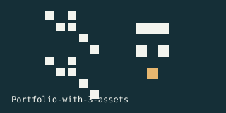

# Portfolio_with_3_assets

Portfolio with 3 assets in R using public stock data retrieved with Google

Visualization:

---

<!-- demo-lab:start -->
## Explore this project

[Project page & walkthrough](https://eforus-overseer.github.io/demo-lab/projects/portfolio-with-3-assets/) — Try an interactive explanation and inspect the original source and results. Browser teaching examples are distinguished from trained models.
<!-- demo-lab:end -->

<!-- codex-pixel-art -->
## Pixel art

A small visual signature for this repository.
